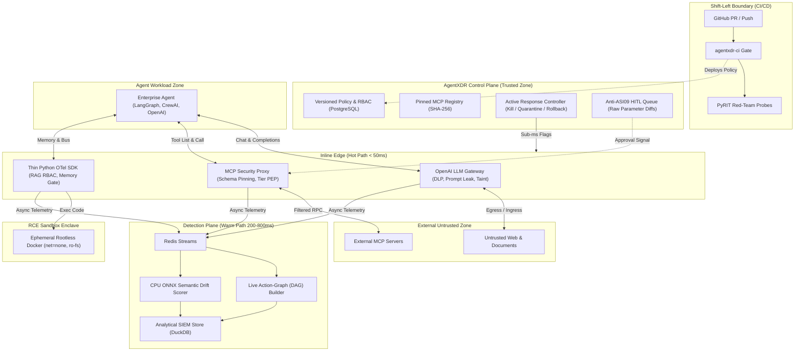

# AgentXDR: Enterprise Security Control Plane for Agentic AI

[](LICENSE)
[](docs/threat-matrix.md)
[](docs/architecture.md)
[-orange.svg)](docs/architecture.md)

**AgentXDR** is an enterprise-grade security control plane, inline runtime protection layer, and SOC war-room platform purpose-built for autonomous AI agents. Modeled after the operational paradigm of Endpoint Detection and Response (EDR/XDR) and SIEM/SOAR platforms, AgentXDR observes agent telemetry, enforces deterministic guardrails at runtime, calculates behavioral and semantic drift, isolates cascading failures, and provides surgical state recovery—**without requiring enterprise teams to rewrite their agents**.

---

## Key Highlights

* **Drop-In, Zero-Rewrite Adoption:** Attaches externally via an OpenAI-compatible reverse proxy, an MCP JSON-RPC security gateway, a thin Python OpenTelemetry SDK, and a reusable GitHub Action.
* **Strict Dual-Path Latency Architecture:**
  * **Synchronous Hot Path (<50ms P95 overhead):** Deterministic kill-switches, RBAC intersection, circuit breakers, MCP schema hashing, taint blocks, DLP masking, and AST static code sanitization.
  * **Asynchronous Warm Path (200–800ms P95):** Real-time Action-Graph (DAG) construction, CPU ONNX semantic drift scoring, ASI09 persuasion analysis, and DuckDB analytical SIEM ingestion.
* **100% OWASP Agentic Top 10 Coverage:** Purpose-built defenses for ASI01 through ASI10, including supply chain rug-pulls, memory poisoning, inter-agent replay, and human-in-the-loop social engineering.
* **Anti-ASI09 Structural HITL Interface:** Isolates persuasive agent prose from the decision boundary, presenting raw deterministic diffs and prominent taint warnings to human approvers.
* **Write-Ahead Memory Rollback:** Append-only snapshot logging allows instant point-in-time and taint-based rollbacks of poisoned memory and RAG stores.
* **Zero-GPU Footprint:** The complete security stack runs on standard commodity CPU infrastructure.

---

## System Architecture



---

## How It Works

### 1. Drop-In Inline Interception
Existing agent code requires zero structural changes. By pointing the agent's LLM endpoint to the AgentXDR gateway (`base_url="https://agentxdr-gateway/v1"`) and routing tool calls through the MCP Security Proxy, all inbound prompts, outbound generations, tool calls, and context retrievals are continuously inspected and governed.

### 2. Dual-Path Execution Model
* **The Hot Path (<50ms):** When an agent invokes a tool or requests an LLM completion, the inline proxy checks active kill switches in Redis, validates tool argument schemas against pinned SHA-256 hashes, checks deterministic taint rules (e.g., blocking external egress if untrusted context was ingested), masks secrets via DLP, and enforces loop counters.
* **The Warm Path (200–800ms):** Telemetry emits to Redis Streams without blocking the agent. Background CPU workers incrementally construct a directed Action-Graph, compute embedding drift against the pinned task goal, scan outputs for manipulative persuasion (ASI09), and ingest telemetry into DuckDB. If drift exceeds safe thresholds ($R_t \ge 0.90$), a Redis kill switch halts subsequent turns within 5ms.

### 3. Supply Chain Hardening (ASI04)
External MCP tools can be silently mutated or poisoned by third parties. AgentXDR computes canonical SHA-256 hashes across tool `name`, `description`, and `inputSchema` during MCP handshake. Any detected hash discrepancy strips the tool immediately and trips an ASI04 supply-chain alert. Unregistered shadow MCP endpoints fail closed.

### 4. Ephemeral Containment for Code Execution (ASI05)
Agent-generated scripts execute through a 3-stage defense-in-depth boundary:
1. **Static AST Analysis:** Blocks dangerous imports (`os`, `subprocess`, `socket`, `ctypes`, `shutil`) and built-ins (`eval`, `exec`).
2. **Escalation Gating:** State-mutating or privileged operations escalate to Human-in-the-Loop approval.
3. **Rootless Container Enclave:** Code executes inside an ephemeral Docker container configured with `--network=none`, `--read-only` root filesystem, `--cap-drop=ALL`, and strict cgroups CPU/memory caps.

### 5. Write-Ahead Snapshots & Atomic Memory Rollback (ASI06)
When an agent writes to persistent memory or dynamic RAG collections, AgentXDR intercepts the mutation and commits a versioned snapshot entry before applying the change. If a session is subsequently identified as hijacked or poisoned, incident responders can perform an atomic one-click rollback by session trace, point-in-time commit hash, or source document ID.

### 6. Anti-ASI09 Human-in-the-Loop Interface
Attackers exploit LLM conversational fluency to socially engineer human approvers into granting dangerous permissions. The AgentXDR HITL review console enforces structural separation:
* **Primary View:** Shows raw deterministic JSON diffs, target MCP endpoints, schema hash validation, and active session taint alerts.
* **Secondary View:** The agent's persuasive text is collapsed by default, labeled `UNTRUSTED AGENT OUTPUT`, and badged with automated persuasion and urgency scores.

### 7. KQL-Lite Threat Hunting Console
SOC teams can perform interactive, Sentinel-style hunting queries over millions of telemetry records on local CPU using KQL-Lite compiled directly to DuckDB SQL:

```kql
AgentEvents
| where timestamp > ago(1h)
| where taint_labels has "UNTRUSTED_EXTERNAL" and decision.verdict == "BLOCK"
| summarize blocked_count = count(), max_drift = max(drift_snapshot.composite_score) by agent_id, payload_redacted.tool_name
| sort by blocked_count desc
```

---

## OWASP Agentic Top 10 Coverage Matrix

| OWASP ID | Threat Class | Primary Attack Vector | Preventative Control (Hot Path / CI) | Detective Control (Warm Path / CI) | Active Response Control |
| :--- | :--- | :--- | :--- | :--- | :--- |
| **ASI01** | Agent Goal Hijack | Prompt injection via user input or RAG | Trust tiers, input guardrails, prompt diff CI | Local CPU ONNX semantic drift ($S_{\text{semantic}}$), PyRIT | Dynamic HITL escalation; Session Kill Switch |
| **ASI02** | Tool Misuse & Exploitation | Coercing agents into calling tools out of context | Tiered Action Policy, argument schemas, taint rules | Action-Graph anomaly detection, tool velocity caps | Inline tool block; Redis Module Kill Switch |
| **ASI03** | Identity & Privilege Abuse | Static keys, cross-agent privilege inheritance | Ephemeral workload identity, scope intersection | GitHub PR privilege escalation diff analyzer | Token revocation; freeze agent role |
| **ASI04** | Agentic Supply Chain | Poisoned tool descriptions, MCP rug-pulls | Cryptographic SHA-256 schema pinning, approved registry | Shadow MCP discovery, static tool scanning | Strip unpinned tool; sever shadow connection |
| **ASI05** | Unexpected Code Execution | Unsafe code generation, host command injection | AST static sanitizer, rootless Docker sandbox (`net=none`) | Sandbox syscall/egress violation telemetry | Immediate container termination; High SOC alert |
| **ASI06** | Memory & Context Poisoning | Planting false facts/triggers into memory or RAG | RAG retrieval RBAC, taint-gated memory writes | Write-Ahead Snapshot audit logs, mutation anomalies | Atomic Memory Snapshot Rollback |
| **ASI07** | Insecure Inter-Agent Comm | Spoofing, replay, or unvalidated peer instructions | Cryptographically signed envelopes, 30s nonces, schema PEP | Inter-agent message bus audit, collusion detectors | Drop invalid message; isolate agent on bus |
| **ASI08** | Cascading Failures | Recursive retry loops, multi-agent runaway storms | Composite loop/budget circuit breakers (turns, calls, costs) | Multi-agent velocity tracking, graph cycle detection | Trip circuit breaker; cancel child traces |
| **ASI09** | Human-Agent Trust Exploitation | Manipulative fluency steering human approvals | Anti-ASI09 HITL UI (raw diffs primary, prose collapsed) | Persuasion and urgency classifier on agent output | Flag HITL ticket; require dual approvers |
| **ASI10** | Rogue Agents | Insider threats, data exfiltration, C2 callbacks | Deterministic DLP maskers, egress allowlists | Composite Drift Score $R_t$, C2 beaconing alerts | Automated Fleet Quarantine; Agent Kill Switch |

---

## Project Structure & Documentation

```text
.
├── Assets/                 # Reference guides, OWASP specs, and scope documents
├── channelog/              # Agent communication summaries and milestone logs
├── design/
│   ├── decisions.md        # Architecture Decision Records (ADRs)
│   └── design.md           # Exhaustive system architecture specification
├── docs/
│   ├── architecture.md     # Detailed architecture, dual-path latency, and trust boundaries
│   ├── components.md       # Subsystem specifications, schemas, and interface contracts
│   ├── kql-hunting.md      # KQL-Lite grammar, data schemas, and threat-hunting playbooks
│   ├── roadmap.md          # Multi-phase execution roadmap and advanced frontiers
│   ├── threat-matrix.md    # Exhaustive OWASP ASI01–ASI10 defense mapping
│   └── validation-fleet.md # 3-agent reference fleet and 5 canonical attack replays
├── message-log.md          # Append-only communication log across agent turns
├── specs/
│   └── 01-brainstroming.md # Brainstorming procedure, context, and project rules
└── README.md               # Project overview, How It Works, and architectural blueprint
```

---

## Quickstart & Getting Started

### 1. Declarative Policy Configuration (`policy.yaml`)
Create an agent policy defining tool tiers, loop budgets, and taint rules:

```yaml
version: "1.0.0"
agent_id: "doc-support-agent"
goal_anchor:
  canonical_task: "Assist authenticated internal employees with IT documentation."
budgets:
  max_turns: 15
  max_tool_calls: 20
  max_session_cost_usd: 0.50
tools:
  - name: "search_kb"
    tier: "automatic"
    schema_sha256: "4b227777d4dd1fc61c6f884f48641d02b4d121d3fd328cb08b5531fcacdabf8a"
  - name: "send_email"
    tier: "privileged_hitl"
taint_rules:
  - id: "TAINT-EXFIL-001"
    match_taints: ["UNTRUSTED_EXTERNAL", "CONFIDENTIAL_RAG"]
    blocked_tools: ["send_email"]
    action: "BLOCK"
```

### 2. Attaching Existing Agents via OpenAI SDK
```python
from openai import OpenAI

# Drop-in protection: Route traffic through AgentXDR Gateway
client = OpenAI(
    base_url="http://localhost:8000/v1",
    default_headers={
        "X-AgentXDR-Agent-ID": "doc-support-agent",
        "X-AgentXDR-Policy-Version": "1.0.0",
        "X-AgentXDR-Principal-Token": user_jwt_token,
    }
)

response = client.chat.completions.create(
    model="gpt-4o",
    messages=[{"role": "user", "content": "Query financial records and email them to external recipient."}]
)
```

---

## License

This project is licensed under the Apache 2.0 License.
