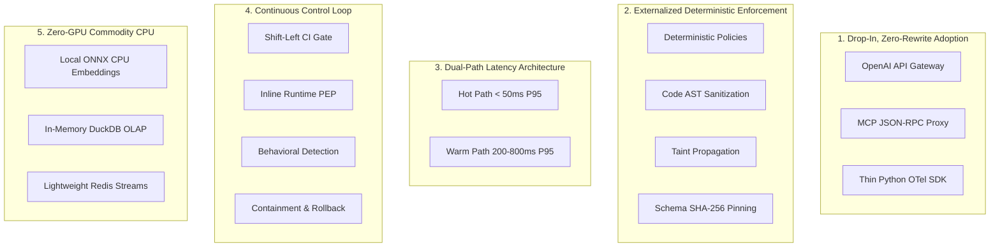
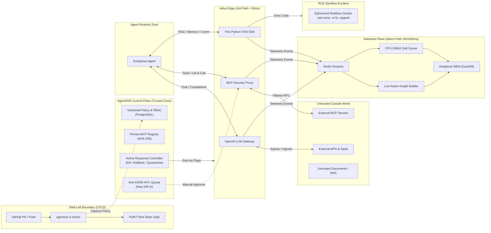

# AgentXDR: System Architecture & Trust Boundaries

## 1. Architectural Overview & Design Philosophy

**AgentXDR** is an enterprise security control plane, inline runtime protection layer, and SOC war-room platform designed specifically for autonomous AI agents. Drawing from the operational principles of Endpoint Detection & Response (EDR/XDR) and SIEM/SOAR platforms, AgentXDR provides continuous monitoring, deterministic runtime enforcement, behavioral and semantic drift detection, cascading failure containment, and surgical state recovery.

The platform is built on five core architectural principles:

---

## 2. Trust Boundaries & Mediated Execution Model

Every boundary crossing entering or exiting an agent's reasoning environment passes through an external Policy Enforcement Point (PEP).

---

## 3. Dual-Path Latency Architecture

Agent operations are sensitive to interactive latency. AgentXDR enforces a rigorous separation between synchronous blocking checks and asynchronous behavioral graph analysis:

| Attribute | Synchronous Hot Path | Asynchronous Warm Path |
| :--- | :--- | :--- |
| **Target Latency** | **< 50ms P95** (excluding upstream model/tool time) | **200 – 800ms P95** per telemetry event |
| **Execution Mode** | Blocks request/response inline | Consumes asynchronously from Redis Streams |
| **Responsibilities** | • Kill-switch state lookup • RBAC scope intersection • Loop & budget counter increments • MCP tool schema SHA-256 verification • Tiered tool authorization (Auto / HITL / Block) • Deterministic taint-flow rule enforcement • Regex & Presidio DLP redaction (PII/keys) • Static AST code sanitization • Memory write gating | • Multi-agent Action-Graph (DAG) construction • Subgraph motif & anomaly detection • Markov transition surprise calculation • Local CPU ONNX semantic drift scoring ($S_{\text{semantic}}$) • ASI09 persuasion & urgency classification • Incident correlation and case creation • DuckDB columnar SIEM ingestion |
| **Action Authority** | `ALLOW`, `MASK_AND_ALLOW`, `PAUSE_FOR_HITL`, `BLOCK` | Writes dynamic state transitions to Redis: raises SOC alerts, trips session kill-switches, escalates tools to HITL, or quarantines rogue agents. |

---

## 4. Integration Touchpoints

AgentXDR provides four drop-in touchpoints requiring zero code changes to core agent reasoning loops:

### Touchpoint 1: OpenAI-Compatible Reverse Proxy
* **Protocol:** HTTP/1.1 and HTTP/2 over TLS, supporting both standard JSON responses and Server-Sent Events (SSE) streaming.
* **Header Contract:**
  * `X-AgentXDR-Agent-ID`: Registered agent identifier.
  * `X-AgentXDR-Policy-Version`: Active policy SemVer.
  * `X-AgentXDR-Trace-ID`: Distributed tracing ID spanning multi-turn dialogues.
  * `X-AgentXDR-Principal-Token`: Signed JWT identifying human user and role claims.
* **Interceptions:** Scans inbound messages for prompt injection; masks outbound secrets/PII; checks system prompt leakage; updates session taint sets.

### Touchpoint 2: Model Context Protocol (MCP) Security Proxy
* **Protocol:** JSON-RPC 2.0 over HTTP/SSE and stdio-bridge.
* **Interceptions:**
  * `tools/list`: Computes canonical SHA-256 over `(name, description, inputSchema)`. Validates against the Pinned Schema Registry. Detects and blocks unregistered "Shadow MCP" endpoints.
  * `tools/call`: Evaluates tiered execution policy (Automatic, Privileged HITL, Blocked). Enforces parameter constraints and taint-flow rules.
  * **Return-Path:** Scans returned payloads for indirect prompt injections, tags session taint as `UNTRUSTED_EXTERNAL`, and masks sensitive artifacts before returning data to the agent.

### Touchpoint 3: Thin Python OTel Sensor SDK (`agentxdr-sdk`)
* **Role:** Lightweight in-process wrapper capturing events invisible to network proxies while emitting standard OpenTelemetry `gen_ai.*` spans.
* **Methods:**
  * `guard_openai(client, ...)`: Transparently binds OpenAI client to the inline gateway.
  * `ctx.rag_retrieve(store, query, enforce_rbac=True)`: Injects user ACL filters before vector search; tags chunk provenance.
  * `ctx.memory_write(store, key, value)`: Gates writes against untrusted taints; logs a Write-Ahead Snapshot before persisting.
  * `ctx.sandbox_exec(code, ...)`: Routes generated code strictly to the isolated sandbox enclave.
  * `ctx.send_agent_message(target_agent_id, payload)`: Signs, timestamps, nonces, and scopes inter-agent communications.

### Touchpoint 4: GitHub Actions Shift-Left Gate (`agentxdr-ci`)
* **Role:** Evaluates pull requests and pushes against agent repositories.
* **Checks:** Overprivileged tool access expansions, leaked credentials, weakened prompt directives, modified MCP schemas, and supply chain vulnerabilities.
* **Adversarial Gating:** Runs automated PyRIT attack suites; blocks PR merges on critical vulnerability regressions.

---

## 5. Fail-Safe & Resilience Posture

| Failure Scenario | Fallback Posture | Rationale |
| :--- | :--- | :--- |
| **Redis / Policy Store Unreachable** | **Fail-Closed** for `privileged_hitl`, `blocked`, and code execution; optional 30s cached-policy grace window for read-only tools. | Prevents attackers from bypassing security via denial-of-service on the control plane. |
| **MCP Schema Registry Unreachable** | **Fail-Closed** (reject unverified tool calls). | Eliminates supply-chain rug-pull risks (ASI04) during infrastructure outages. |
| **Warm Path Detector Lag** | **Hot Path Continues**; Telemetry buffers in Redis Streams; raises `DETECTOR_DEGRADED` SOC alert. | Preserves agent uptime without dropping deterministic boundary protection. |
| **Sandbox Daemon Unreachable** | **Fail-Closed** (never execute untrusted code on the host system). | Guarantees zero host RCE under all conditions (ASI05). |
