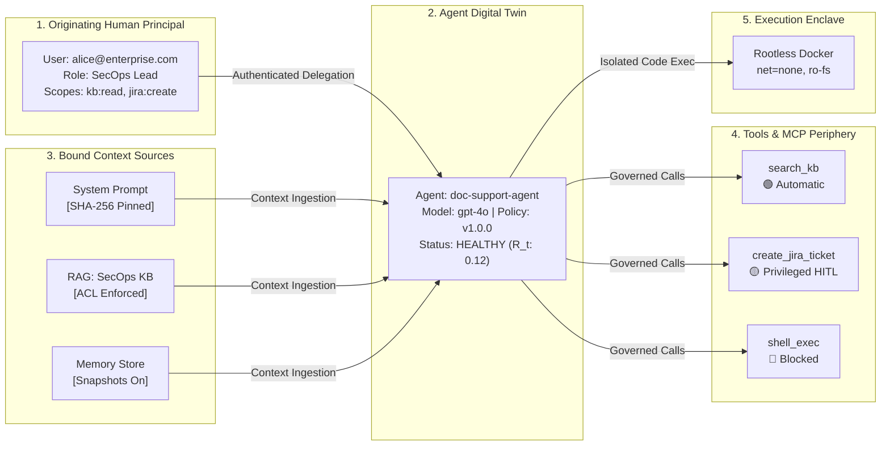

# AgentXDR: Subsystem & Component Specifications

This document defines the technical specifications, execution contracts, and interfaces for the seven core subsystems composing AgentXDR.

---

## 1. Subsystem 1: Shift-Left CI/CD Security & Pre-Deployment Red Teaming

### 1.1 GitHub PR & Push Security Analyzers (`agentxdr-ci`)
Evaluates every pull request and commit against five deterministic static analyzers:
1. **Overprivileged Tool Access Analyzer:** Scans diffs in `policy.yaml` and tool definitions. Flags widening permissions (`blocked -> privileged_hitl` or `privileged_hitl -> automatic`), wildcard tool assignments (`*`), or loosened egress URL patterns.
2. **Authentication & Authorization Analyzer:** Detects hardcoded secrets, disabled delegation flags, bypassed RAG ACL checks, or shared master API keys.
3. **Dependencies & Supply Chain Monitor:** Audits Python dependencies (`requirements.txt`, `pyproject.toml`) and MCP declarations (`mcp.json`) against known CVE databases and enforces approved tool vendor lists.
4. **System Instructions & Guardrail Diff Monitor:** Parses system prompt templates to detect weakening of security boundaries, constraint deletions, or conflicting directives.
5. **Tool & Context Schema Monitor:** Computes SHA-256 hashes of declared MCP tool schemas and verifies alignment with the pinned registry.

### 1.2 Pre-Deployment Adversarial Red Teaming (PyRIT)
* Integrates Microsoft PyRIT to orchestrate single-turn and multi-turn adversarial attack converters (direct jailbreaks, RAG document poisoning, tool-parameter manipulation, and ASI09 persuasion attempts).
* **Gating Policy:** Generates an Attack Success Rate (ASR) scorecard mapped to OWASP ASI01–ASI10. PRs fail automatically if $\text{ASR}_{\text{critical}} > 0\%$.

---

## 2. Subsystem 2: Context, Provenance & Data Governance Layer

### 2.1 The Five Context Sources & Trust Tiers

| Source | Default Provenance Tier | Security Governance |
| :--- | :--- | :--- |
| **1. System Instructions** | `TRUSTED_SYSTEM` | SHA-256 hashed at deploy time; verified immutable at runtime; monitored for outbound prompt leakage. |
| **2. User Input** | `AUTHENTICATED_USER` | Scanned by input guardrails; bound to verified user principal identity and JWT claims. |
| **3. RAG Documents** | `RESTRICTED_INTERNAL` or `UNTRUSTED_EXTERNAL` | Pre-retrieval metadata filtering by user ACL; injection scanning; chunk-level provenance tagging. |
| **4. Persistent Memory** | `VERIFIED_MEMORY` | Gated writes; tainted turns blocked from persisting; all writes recorded in Write-Ahead Snapshot Log. |
| **5. Tool Outputs** | `UNTRUSTED_EXTERNAL` | Tool schemas SHA-256 pinned; returned payloads sanitized; propagates taint labels to session state. |

### 2.2 Session Taint Propagation State Machine
Maintained in Redis as a set of monotonic labels for each active `trace_id`:
* Possible Taints: `UNTRUSTED_EXTERNAL`, `CONFIDENTIAL_RAG`, `CONTAINS_PII`, `SUSPECTED_INJECTION`.
* Taint labels propagate across all intermediate steps, inter-agent messages, and tool invocations.
* **Deterministic Rules:** Evaluated prior to every tool invocation (e.g., if $\text{Taints} \supseteq \{\text{UNTRUSTED\_EXTERNAL}, \text{CONFIDENTIAL\_RAG}\}$, external communication tools are hard-blocked).

---

## 3. Subsystem 3: Inline Guardrails & Tiered Action Policy Engine

### 3.1 Declarative Policy Specification (`policy.yaml`)
Each agent is governed by an immutable, versioned YAML contract:

```yaml
version: "1.0.0"
agent_id: "doc-support-agent"
policy_hash: "sha256:e3b0c44298fc1c149afbf4c8996fb92427ae41e4649b934ca495991b7852b855"
approved_by: "secops-lead@enterprise.com"

goal_anchor:
  canonical_task: "Assist authenticated internal employees with IT documentation and troubleshooting."
  allowed_domains: ["it-kb", "support-tickets"]

budgets:
  max_turns: 15
  max_tool_calls: 20
  max_identical_calls: 3
  max_session_duration_sec: 180
  max_session_cost_usd: 0.50

tools:
  - name: "search_internal_kb"
    mcp_server: "kb-server"
    tier: "automatic"
    schema_sha256: "a1b2c3..."
    parameters:
      query: { type: "string", max_length: 500 }
  - name: "escalate_to_jira"
    mcp_server: "jira-server"
    tier: "privileged_hitl"
    schema_sha256: "d4e5f6..."
  - name: "execute_system_command"
    tier: "blocked"

taint_rules:
  - id: "TAINT-EXFIL-001"
    match_taints: ["UNTRUSTED_EXTERNAL", "CONFIDENTIAL_RAG"]
    blocked_tools: ["send_email", "post_webhook"]
    action: "BLOCK"
    owasp_id: "ASI02"

code_sandbox:
  enabled: true
  provider: "docker_rootless"
  timeout_sec: 10
  memory_limit_mb: 256
  blocked_imports: ["os", "subprocess", "socket", "ctypes", "requests"]

output_guardrails:
  dlp:
    mask_pii: true
    mask_secrets: true
  prompt_leak:
    max_similarity: 0.65
```

### 3.2 Tiered Action Execution Model
* **Tier 0 (`automatic`):** Read-only, idempotent actions executed after parameter schema and taint validation.
* **Tier 1 (`privileged_hitl`):** State-mutating, financial, or external communication actions. Execution pauses deterministically; creates a ticket in the Anti-ASI09 HITL Queue with a 15-minute TTL.
* **Tier 2 (`blocked`):** Dangerous capabilities rejected unconditionally with HTTP 403.

---

## 4. Subsystem 4: Identity, Versioned RBAC & Inter-Agent Bus Security

### 4.1 Permission Intersection & Attenuation
* Effective authorization is strictly computed as:
  $$\text{Effective Scope} = \text{Scope}_{\text{User}} \cap \text{Scope}_{\text{Agent Role}} \cap \text{Scope}_{\text{Task Policy}}$$
* Multi-hop delegation narrows permissions monotonically:
  $$\text{Scope}_{A \to B} \subseteq \text{Effective Scope}_{A} \cap \text{Scope}_{\text{Agent } B}$$

### 4.2 Cryptographic Inter-Agent Communication Envelope
All agent-to-agent messages pass through the control plane bus enclosed in a signed envelope:

```json
{
  "message_id": "msg-01934e8f-7c1a-7b3b-8f0a-123456789abc",
  "trace_id": "trace-889102-prod",
  "sender_agent_id": "doc-support-agent",
  "receiver_agent_id": "data-analyst-agent",
  "timestamp_utc": "2026-11-22T14:30:00Z",
  "nonce": "c4ca4238a0b923820dcc509a6f75849b",
  "attenuated_token": "eyJhbGciOi...",
  "taint_labels": ["UNTRUSTED_EXTERNAL"],
  "payload": {
    "action": "query_metrics",
    "parameters": {"date_range": "last_30d"}
  },
  "signature": "30450221008f...edcba"
}
```

---

## 5. Subsystem 5: Unexpected Code Execution (RCE) Containment Sandbox

### 5.1 Three-Stage Execution Boundary
1. **Stage 1 — AST Static Sanitizer:** Parses source code into Python AST; rejects forbidden imports (`os`, `subprocess`, `socket`, `ctypes`, `shutil`), built-ins (`eval`, `exec`), and dunder inspection.
2. **Stage 2 — Escalation Policy:** Pure read-only transformations execute automatically inside the sandbox; code modifying external state or requesting elevated scopes escalates to `privileged_hitl`.
3. **Stage 3 — Ephemeral Rootless Container:**
   * Container flags: `--network=none`, `--read-only`, `--cap-drop=ALL`, `--security-opt=no-new-privileges`.
   * Cgroups caps: 256 MB RAM, 10s CPU timeout, PID limit 32.
   * Container destroyed immediately upon return; stdout/stderr scanned by DLP before returning.

### 5.2 Pluggable Provider Interface
```python
class SandboxProvider(ABC):
    @abstractmethod
    def execute(self, code: str, timeout_sec: int, memory_mb: int) -> SandboxResult:
        pass
```
* **Implementations:** `DockerRootlessProvider` (Production default), `SubprocessRestrictedProvider` (Local development/CI fallback).

---

## 6. Subsystem 6: Behavioral Observability, Action-Graph & Drift Detection

### 6.1 Live Action-Graph (DAG) Construction
For every `trace_id`, an execution graph $G = (V, E)$ is updated in real time:
* **Nodes ($V$):** `USER`, `RAG_DOC`, `LLM_STEP`, `TOOL_CALL`, `MEMORY_STORE`, `SANDBOX`, `PEER_AGENT`.
* **Edges ($E$):** `READS_FROM`, `INVOKES`, `WRITES_TO`, `DELEGATES_TO`, `RETURNS_TO`.
* **Graph Analyzers:** Detects forbidden taint motifs (e.g., `UNTRUSTED_EXTERNAL -> TOOL_CALL -> EGRESS`), Markov transition surprise, and delegation cycle deadlocks.

### 6.2 Composite Drift Scoring Model
Calculates risk score $R_t \in [0.0, 1.0]$ at step $t$:
$$R_t = \min\Big(1.0,\; 0.45\,S_{\text{policy}}(t) + 0.25\,S_{\text{graph}}(t) + 0.15\,S_{\text{velocity}}(t) + 0.15\,S_{\text{semantic}}(t)\Big)$$

* $S_{\text{policy}}(t)$: Severity of deterministic rule violations (critical violations force $R_t = 1.0$).
* $S_{\text{graph}}(t)$: Graph structural anomaly score.
* $S_{\text{velocity}}(t)$: Ratio against turn, call, and token budget ceilings.
* $S_{\text{semantic}}(t)$: Goal-anchor cosine distance computed on CPU via ONNX embeddings (`bge-small-en-v1.5`) over a 3-step sliding window.

---

## 7. Subsystem 7: Active Response, Containment & State Recovery Controller

### 7.1 Hierarchical Kill Switches
* **Tool / Module Kill Switch:** Disables a compromised tool or MCP server instantly across the fleet.
* **Session Kill Switch:** Terminates a specific `trace_id` thread without disrupting other concurrent users.
* **Agent Kill Switch:** Halts all executions for a specific agent instance.
* **Global Flow Kill Switch:** Emergency red button halting all multi-agent workflows.

### 7.2 Write-Ahead Memory & RAG Snapshot Rollback
* Records all intercepted writes in an append-only snapshot log:
  $$\text{Commit} = (\text{commit\_id}, \text{trace\_id}, \text{agent\_id}, \text{key}, \text{prev\_val}, \text{new\_val}, \text{taint\_labels}, \text{timestamp})$$
* **Atomic Rollbacks:**
  * **Session Rollback:** Reverts all writes made during a hijacked trace.
  * **Point-in-Time Rollback:** Restores agent memory to any historical commit ID.
  * **Taint-Based Purge:** Cascading rollback of all writes originating from a poisoned RAG document.

### 7.3 Anti-ASI09 HITL Approval Interface
* **Deterministic Diff Pane (Primary View):** Displays verified tool target, schema hash, raw parameter diffs, and Taint Warning banner.
* **Untrusted Agent Rationale Pane (Secondary View):** Collapsed by default; badged as `UNTRUSTED AGENT OUTPUT`; highlights persuasion and urgency classifier scores.


---

## 8. Subsystem 8: Visual Control Plane & Live Agent Topology Mapping (AgentXDR Canvas)

To eliminate the "black-box" dilemma of autonomous agent systems, AgentXDR provides an enterprise-grade visual control cockpit featuring two synchronized graphical views: the **Agent Topology & Capability Map** (static governance blueprint) and the **Live Graphical Execution DAG** (dynamic real-time war-room).



### 8.1 View 1: Agent Topology & Capability Blueprint

Whenever an agent is onboarded or inspected in the SOC console, AgentXDR renders a comprehensive capability blueprint:

1. **User-Principal Node (The Human Origin):**
   * Displays verified user identity: username, email, department/tenant, authenticated session ID.
   * Visualizes assigned roles and effective token permissions computed via permission intersection:
     $$\text{Effective Scope} = \text{Scope}_{\text{User}} \cap \text{Scope}_{\text{Agent Role}} \cap \text{Scope}_{\text{Task Policy}}$$
   * Displays token lifetime and delegation chain hierarchy.
2. **Agent Digital Twin Node (Central Command Hub):**
   * Displays Agent Name, registered ID, foundation model endpoint, pinned SemVer policy version, and approval timestamp.
   * Displays the canonical `goal_anchor` text and task boundaries.
   * Real-time status pill badge:
     * 🟢 `HEALTHY`: Normal operation, $R_t < 0.55$.
     * 🔵 `IN_FLIGHT`: Actively evaluating reasoning turn.
     * 🟡 `HITL_PENDING`: Execution paused awaiting human adjudication.
     * 🟠 `DEGRADED`: Elevated drift or velocity warnings.
     * 🔴 `QUARANTINED` / `KILLED`: Bus severed, execution frozen.
   * Live composite drift meter ($R_t \in [0.0, 1.0]$) decomposing policy, graph, velocity, and semantic drift.
3. **Context Periphery Cards:**
   * **System Prompt:** Displays SHA-256 integrity hash, character count, and immutability status.
   * **RAG Collections:** Lists attached vector/semantic collections, user ACL boundary rules, and injection sanitization status.
   * **Persistent Memory:** Displays memory store namespace, snapshotting state, write-gate status, and active commit count.
4. **Tool & MCP Periphery Cards:**
   * Grouped visually by MCP server (e.g., `jira-mcp-server`, `email-gateway`, `postgres-mcp`).
   * Each tool card renders:
     * Authorization Tier Pill: 🟢 `automatic`, 🟡 `privileged_hitl`, 🔴 `blocked`.
     * Cryptographic Schema Pin: `SHA-256: VERIFIED` (green check) or `MISMATCH / POISONED` (red alert).
     * Parameter Schema summary and outbound egress domain allowlists.
5. **Execution Enclave Card:**
   * Displays active `SandboxProvider` type (`DockerRootlessProvider` vs `SubprocessRestrictedProvider`).
   * Renders active security constraints: `--network=none`, `--read-only`, RAM limit (256 MB), CPU timeout (10s), dropped capabilities (`CAP_DROP=ALL`).

---

### 8.2 View 2: Live Graphical Execution DAG (The War-Room Cockpit)

During active agent reasoning sessions or retrospective incident forensic investigations, AgentXDR renders an interactive, animated causal execution graph:

```mermaid
flowchart LR
    U["👤 User: alice@corp"] -->|Prompt| P["📝 USER_INPUT<br/>DLP: Clean"]
    P -->|Ingest| R["📚 RAG_ACCESS<br/>ACL: Verified"]
    R -->|Context| L1["🧠 LLM_STEP 1<br/>Reasoning Turn"]
    L1 -->|Call| T1["⚙️ TOOL: search_kb<br/>🟢 Auto: Allowed (8ms)"]
    T1 -->|Return| L2["🧠 LLM_STEP 2<br/>Taint: ⚠️ UNTRUSTED"]
    L2 -->|Call| T2["⚙️ TOOL: send_email<br/>🟡 HITL Paused (Ticket #104)"]
    T2 -.->|Approved| OUT["📤 FINAL_OUTPUT<br/>Masked PII"]

    classDef allowed fill:#e6ffed,stroke:#2ea44f,stroke-width:2px;
    classDef paused fill:#fff8c5,stroke:#d4a72c,stroke-width:2px;
    classDef tainted fill:#ffebe9,stroke:#cf222e,stroke-width:2px;
    classDef user fill:#ddf4ff,stroke:#0969da,stroke-width:2px;

    class U user;
    class T1 allowed;
    class T2 paused;
    class L2 tainted;
```



#### Dynamic Visual States & Capabilities
* **Pulsing Active Nodes:** The step currently being evaluated pulses with an animated boundary.
* **Animated Data Particles:** Edges feature moving particles representing streaming tokens or JSON-RPC payloads.
* **Dynamic Taint Badges:** When an external document or unverified tool output is ingested, a bright visual badge (`⚠️ UNTRUSTED_EXTERNAL` or `🔒 CONFIDENTIAL_RAG`) attaches to the causal arrow and propagates visibly downstream to all subsequent nodes.
* **Step-by-Step Drift Decomposition Bar:** Displayed below each LLM node showing the exact progression of risk:
  $$R_t = 0.10 \longrightarrow 0.35 \longrightarrow 0.78 \longrightarrow 0.92 \text{ (TRIPPED)}$$
* **Interactive Node Inspector:** Clicking any node in the canvas opens an inspection drawer showing:
  * Raw and redacted JSON payloads.
  * Deterministic rule evaluations and OWASP category tags.
  * Step latency ($12\text{ ms}$) and cumulative token cost (\$0.004).
* **Direct Canvas Action Controls:** Security operators can execute active containment directly from the graph:
  * 🔴 **Kill Trace:** Halts the live session instantly.
  * 🛑 **Quarantine Agent:** Isolates the agent from the inter-agent bus.
  * ⏪ **Rollback Memory:** One-click rollback of all memory/RAG mutations up to the selected step.
  * 🛡️ **Escalate to HITL:** Pauses remaining tool calls for manual operator review.
