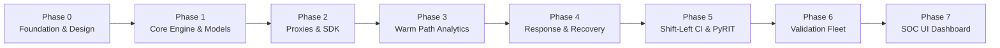

# AgentXDR: Execution Roadmap & Future Frontiers

This document defines the multi-phase engineering roadmap for delivering AgentXDR, along with strategic recommendations for future agentic security research.

---

## 1. Execution Roadmap & Phase Breakdown

### Phase 0: Project Governance, Design & Repository Setup (Current)
* [x] Project root realignment and `.gitignore` setup.
* [x] Complete system design specification (`design/design.md`).
* [x] Architecture Decision Records (`design/decisions.md`).
* [x] Core documentation suite (`docs/`).
* [x] Governance and channel logs (`channelog/01-brainstorming.md`, `message-log.md`).

### Phase 1: Core Engine, Policy Evaluator & Deterministic Guardrails (`agentxdr-core`)
* Pydantic schemas: `AgentEvent`, `PolicySchema`, `TaintState`, `KillSwitchState`.
* Deterministic DLP masking engine (PII, API keys, credentials, prompt leakage).
* Python AST static code sanitizer.
* Tiered Policy Evaluator (`automatic`, `privileged_hitl`, `blocked`).
* Hard loop and budget circuit breakers (turns, tool calls, identical call loops, duration, cost).

### Phase 2: Runtime Proxies & In-Process SDK (`agentxdr-proxy` & `agentxdr-sdk`)
* FastAPI-based OpenAI-compatible HTTP/SSE reverse proxy (`/v1/chat/completions`).
* MCP Security Proxy (JSON-RPC 2.0) with canonical SHA-256 schema hashing and shadow MCP detection.
* Thin Python SDK (`agentxdr-sdk`) with OpenTelemetry `gen_ai.*` tracing, RAG ACL metadata filtering, and signed inter-agent envelopes.

### Phase 3: Warm-Path Analytics Plane & KQL-Lite SIEM Engine
* Redis Streams telemetry pipeline consumer.
* Live Action-Graph (DAG) builder and subgraph motif anomaly detectors.
* Local CPU ONNX semantic drift calculator (`fastembed` with `bge-small-en-v1.5`).
* Persuasion and urgency classifier for ASI09 detection.
* Embedded DuckDB analytical store and KQL-Lite grammar compiler.

### Phase 4: Active Response, Containment & Memory Recovery Controller
* Sub-millisecond Redis Pub/Sub kill switches (Session, Tool, Agent, Global Fleet).
* Write-Ahead Memory & RAG Snapshot Log with atomic rollback APIs.
* Anti-ASI09 Human-in-the-Loop (HITL) approval queue and verification engine.
* Rootless Docker sandbox provider with resource caps and fallback provider.

### Phase 5: Shift-Left CI/CD Gate & Adversarial Testing (`agentxdr-ci`)
* GitHub Action analyzing PR diffs for overprivileged tools, prompt drift, and dependency CVEs.
* Microsoft PyRIT automated red-teaming converter suites mapped to OWASP ASI01–ASI10.
* Automated SARIF reporting and PR commit status gating.

### Phase 6: Reference Demo Fleet & Attack Scenarios
* Implementation of the 3-agent reference fleet (`doc-support-agent`, `data-analyst-agent`, `ops-comms-agent`).
* Scripted reproduction of the 5 canonical attack chains proving prevention, detection, containment, and rollback.

### Phase 7: SOC War-Room Dashboard (`agentxdr-ui`)
* Next.js / React Flow web console:
  * OWASP ASI01–ASI10 10-tile Command Overview.
  * Live Trace & Action-Graph DAG Explorer with step-by-step drift scrubber.
  * KQL-Lite Threat Hunting Console.
  * Anti-ASI09 HITL Approval Queue with raw diffs and persuasion warnings.
  * Active Response Drawer (Kill Switches, Memory Rollbacks, Quarantines).

---

## 2. Advanced Strategic Recommendations & Next-Gen Frontiers

To maintain industry leadership in agentic cybersecurity, we recommend advancing beyond baseline OWASP compliance into the following four frontiers:

### 1. Dynamic Semantic Canaries for RAG & Context Poisoning
* **Concept:** Dynamically embed invisible, high-entropy semantic watermarks ("canary tokens") inside internal RAG document chunks.
* **Mechanism:** If an agent attempts to exfiltrate or summarize text derived from those chunks over an external channel (email, HTTP post, webhook), the Inline Gateway identifies the canary signature immediately—even if paraphrased or summarized by the LLM—and halts the exfiltration inline.

### 2. Cryptographic Agent Attestation & Hardware Enclaves (Confidential Computing)
* **Concept:** Bind agent workload identities to hardware TPMs or AMD SEV-SNP / Intel SGX confidential enclaves.
* **Mechanism:** Guarantees that agent prompt weights, system instructions, and tool tokens cannot be tampered with by a compromised host operating system or malicious hypervisor.

### 3. Multi-Agent Differential Privacy & Zero-Knowledge Delegation
* **Concept:** When collaborating agents delegate tasks across organization boundaries, apply zero-knowledge proofs (ZK-proofs) and differential privacy.
* **Mechanism:** Agent A proves that a computation or request complies with enterprise policy without exposing underlying customer PII, prompt context, or proprietary reasoning chains to Agent B.

### 4. Autonomous Self-Healing Security Playbooks
* **Concept:** Close the loop between threat detection and policy generation.
* **Mechanism:** When the Warm Path detects repeated near-threshold semantic drift or suspicious tool parameters from an agent, AgentXDR automatically proposes a tightened `policy.yaml` patch (e.g., restricting parameter regexes or demoting an automatic tool to HITL) and opens a GitHub PR with full forensic context for SecOps approval.
