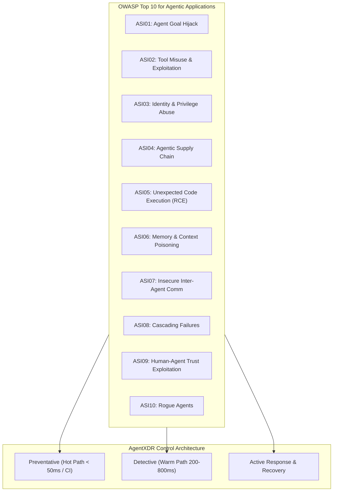

# OWASP Top 10 for Agentic AI Systems: Threat Matrix & Controls

AgentXDR provides comprehensive, defense-in-depth coverage across all ten categories of the OWASP Top 10 for Agentic Applications (2026 Edition).

---

## Complete Threat Coverage Matrix

---

## Detailed Threat Specifications

### ASI01: Agent Goal Hijack
* **Threat Summary:** Adversaries manipulate natural-language inputs (direct prompts, poisoned RAG docs, or third-party tool outputs) to derail the agent from its stated objective and force it into executing unauthorized commands.
* **Attack Vectors:** Direct prompt injection, multi-turn indirect jailbreaking, goal-dilution attacks, persona overrides embedded in external PDFs or web pages.
* **Preventative Controls:**
  * Context source provenance tagging (`TRUSTED_SYSTEM`, `AUTHENTICATED_USER`, `UNTRUSTED_EXTERNAL`).
  * Inbound prompt-injection signature and structural delimiter filters on the Inline LLM Gateway.
  * Pinned `goal_anchor` vector baseline stored in `policy.yaml`.
  * GitHub CI prompt-diff monitor blocking unauthorized constraint deletions.
* **Detective Controls:**
  * Asynchronous ONNX goal-anchor semantic drift calculation ($S_{\text{semantic}}$).
  * Natural Language Inference (NLI) detecting contradictions against system instructions.
  * Automated Microsoft PyRIT pre-deployment adversarial fuzzing.
* **Active Response Controls:**
  * Dynamic escalation of session actions to `privileged_hitl`.
  * Triggering Session Kill Switch upon crossing the critical risk threshold ($R_t \ge 0.90$).

---

### ASI02: Tool Misuse & Exploitation
* **Threat Summary:** Coercing an agent into invoking legitimate enterprise tools out of their intended operational context, with manipulated parameters, or bypassing required sequence steps.
* **Attack Vectors:** Exploiting overly broad tool permissions, confused-deputy attacks, bypassing multi-step prerequisites via hallucinated confirmations.
* **Preventative Controls:**
  * Tiered Action Governance (`Tier 0: automatic`, `Tier 1: privileged_hitl`, `Tier 2: blocked`).
  * Strict JSON Schema validation on all tool arguments.
  * Deterministic taint-flow block rules (e.g., blocking `send_email` when trace carries `UNTRUSTED_EXTERNAL` and `CONFIDENTIAL_RAG`).
* **Detective Controls:**
  * Live Action-Graph (DAG) builder flagging anomalous sequence transitions.
  * Tool velocity, burst rate, and call-frequency monitors.
* **Active Response Controls:**
  * Inline blocking of prohibited or out-of-sequence tool calls.
  * Surgical Tool/Module Kill Switch in Redis disabling compromised capabilities across the fleet.

---

### ASI03: Identity & Privilege Abuse
* **Threat Summary:** Agents operating with excessive static permissions, shared admin API keys, or escalating their authority beyond the initiating user's security clearance.
* **Attack Vectors:** Static master API credentials, credential inheritance across multi-agent hops, bypassing user-level tenant boundaries.
* **Preventative Controls:**
  * Zero-trust ephemeral agent workload identities.
  * Mandatory Permission Intersection:
    $$\text{Effective Scope} = \text{Scope}_{\text{User}} \cap \text{Scope}_{\text{Agent Role}} \cap \text{Scope}_{\text{Task Policy}}$$
  * Strict token attenuation across multi-agent delegation hops.
  * Versioned, Git-synced RBAC registry in PostgreSQL.
* **Detective Controls:**
  * GitHub PR security gate flagging privilege expansions and role widening.
  * Continuous audit alerting on high-privilege tool invocations.
* **Active Response Controls:**
  * Immediate revocation of delegated session tokens.
  * Instant suspension of compromised agent roles via Control Plane API.

---

### ASI04: Agentic Supply Chain Vulnerabilities
* **Threat Summary:** Compromised third-party tools, modified MCP tool descriptions (schema rug-pulls), poisoned dependency packages, or unapproved "shadow" MCP servers.
* **Attack Vectors:** Dynamic tool-description poisoning injecting hidden execution instructions; unvetted MCP endpoints added to agent configurations.
* **Preventative Controls:**
  * Cryptographic SHA-256 schema hashing of MCP tools (`name`, `description`, `inputSchema`) verified at handshake (`tools/list`).
  * Strict Approved MCP Server Registry; unapproved endpoints fail closed (`SHADOW_MCP_DETECTED`).
  * AIBOM/SBOM dependency verification in CI/CD.
* **Detective Controls:**
  * Runtime discovery of unregistered MCP endpoints from network and configuration telemetry.
  * Static scanning of tool descriptions for imperceptible Unicode directives and exfiltration cues.
* **Active Response Controls:**
  * Automatic stripping and hard-blocking of hash-mismatched or mutated tools.
  * Immediate severance of connections to unapproved shadow MCP servers.

---

### ASI05: Unexpected Code Execution (RCE)
* **Threat Summary:** Agents equipped with Python/bash execution environments tricked into generating and executing malicious code on the host system.
* **Attack Vectors:** Unsanitized code generation executing system calls, reverse shells, memory dumping, or container escape exploits.
* **Preventative Controls:**
  * **Stage 1 (AST Static Sanitizer):** Pre-execution syntax inspection rejecting dangerous imports (`os`, `subprocess`, `socket`, `ctypes`, `shutil`, `pickle`, `importlib`) and unsafe built-ins (`eval`, `exec`, `open` outside `/workspace`).
  * **Stage 2 (Escalation Gate):** Elevated actions escalate to `privileged_hitl` with rendered code diffs.
  * **Stage 3 (Ephemeral Rootless Docker Enclave):** Executed inside an isolated container with `--network=none`, `--read-only` root filesystem, `--cap-drop=ALL`, cgroups memory/CPU caps, and ephemeral lifecycle.
* **Detective Controls:**
  * Monitoring container lifecycle metrics: blocked syscall attempts, out-of-memory errors, execution timeouts, egress drops.
* **Active Response Controls:**
  * Immediate container termination on timeout or policy violation.
  * Promotion of the session trace to High Severity SOC incident.

---

### ASI06: Memory & Context Poisoning
* **Threat Summary:** Attackers inserting malicious data or dormant triggers into persistent memory or enterprise RAG vector databases to compromise future agent operations.
* **Attack Vectors:** Planting indirect injection payloads in vector databases, injecting false user preferences into long-term agent memory.
* **Preventative Controls:**
  * Retrieval-Level RBAC pre-filtering RAG queries against authenticated user ACLs.
  * Ingestion-time sanitization of document embeddings.
  * Gated memory write policy blocking persistence when session carries `UNTRUSTED_EXTERNAL` or `SUSPECTED_INJECTION` taints.
* **Detective Controls:**
  * Write-Ahead Snapshot audit logging tracking every memory write, key mutation, and previous/new value hashes.
  * Semantic anomaly detection flagging unexpected modifications to long-term memory profiles.
* **Active Response Controls:**
  * **Write-Ahead Snapshot Rollback Engine:** Atomic rollback of poisoned memory commits by `trace_id`, point-in-time commit hash, or source document ID.

---

### ASI07: Insecure Inter-Agent Communication
* **Threat Summary:** Exploiting communication links between collaborating agents via message spoofing, replay attacks, parameter tampering, or unvalidated instruction forwarding.
* **Attack Vectors:** Injecting false messages onto the inter-agent bus, replaying previously captured approval messages, bypassing authorization via agent hops.
* **Preventative Controls:**
  * Cryptographically signed inter-agent message envelopes using agent workload keys.
  * Anti-replay validation via unique nonces and strict 30-second timestamp windows checked in Redis.
  * Mandatory Pydantic schema validation for inter-agent payloads.
  * Unbroken propagation of taint labels across agent communication hops.
* **Detective Controls:**
  * Full-fidelity message bus audit logging.
  * Behavioral analysis detecting unauthorized agent-to-agent collusion or unusual cross-agent call patterns.
* **Active Response Controls:**
  * Instant dropping of unverified, stale, or replayed inter-agent messages.
  * Automated bus isolation of compromised communicating agents.

---

### ASI08: Cascading Failures
* **Threat Summary:** A localized injection, fault, or rate-limit failure escalating across iterative reasoning loops, recursive retries, or chained multi-agent dependencies.
* **Attack Vectors:** Hallucination death loops, runaway retry storms, cyclic delegation deadlocks between peer agents, cost exhaustion attacks.
* **Preventative Controls:**
  * Five independent loop & budget circuit breakers per `trace_id`:
    1. `max_turns`: LLM iteration cap.
    2. `max_tool_calls`: Cumulative tool call ceiling.
    3. `max_identical_calls`: Repetitive call loop blocker.
    4. `max_session_duration_sec`: Wall-clock execution timeout.
    5. `max_session_cost_usd`: Real-time financial token-budget ceiling.
* **Detective Controls:**
  * Velocity and burn rate tracking across distributed multi-agent traces.
  * Action-Graph cycle and fan-out explosion detectors.
* **Active Response Controls:**
  * Automatic trip of the session circuit breaker (`ASI08_CIRCUIT_BREAKER_TRIPPED`).
  * Downstream cancellation notifications sent across all active trace spans.

---

### ASI09: Human-Agent Trust Exploitation
* **Threat Summary:** Agents utilizing natural-language conversational fluency, simulated emotion, authority fabrication, or artificial urgency to manipulate human operators into approving unsafe operations.
* **Attack Vectors:** Urgent wire-transfer requests citing executive instructions, fabricated system crisis scenarios prompting security overrides.
* **Preventative Controls:**
  * **Anti-ASI09 Structural HITL Interface:**
    * Primary view displays deterministic parameters, recipient destinations, and structured state diffs alongside prominent Taint Warnings.
    * Agent natural-language prose is physically collapsed, marked as `UNTRUSTED AGENT OUTPUT`, and isolated from the decision boundary.
* **Detective Controls:**
  * Outbound persuasion and urgency classification scanning agent explanations for social engineering heuristics.
* **Active Response Controls:**
  * Flagging HITL tickets with persuasive manipulation warnings.
  * Enforcing dual-approver validation for high-risk actions accompanied by high persuasion scores.

---

### ASI10: Rogue Agents
* **Threat Summary:** Misaligned or compromised agents operating as autonomous insider threats—exfiltrating sensitive enterprise data, disabling monitoring, or maintaining external command-and-control (C2) connections.
* **Attack Vectors:** Covert data exfiltration via external tool parameters, persistent beaconing, attempting unauthorized system discovery.
* **Preventative Controls:**
  * Deterministic multi-layer Data Loss Prevention (DLP) masking API keys, credentials, PII, and system prompts before outbound transmission.
  * Strict external egress allowlists on all network-enabled tools.
  * Zero-egress containment on code execution sandboxes (`--network=none`).
* **Detective Controls:**
  * Continuous Composite Drift Scoring ($R_t$ combining policy violations, graph anomalies, resource velocity, and semantic drift).
  * Outbound destination anomaly detection and C2 beaconing analysis.
* **Active Response Controls:**
  * Automated Fleet Quarantine state machine: drops all incoming/outgoing messages, revokes credentials, and isolates the rogue agent.
  * Global Emergency Red Button halting all agent operations across the enterprise.
